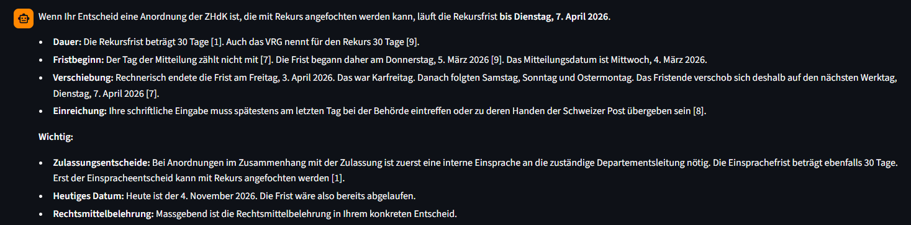
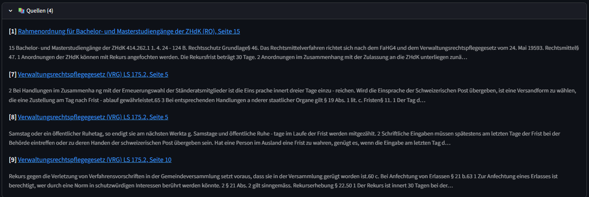
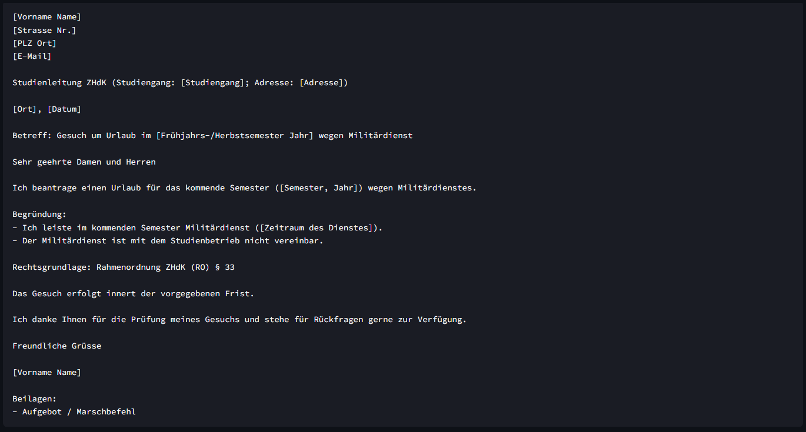
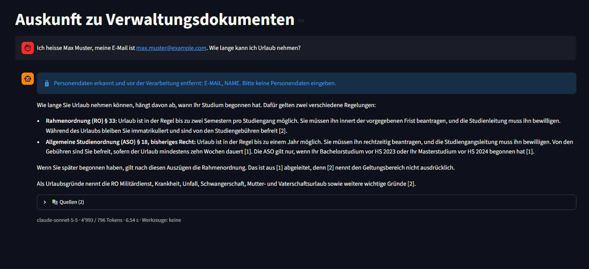
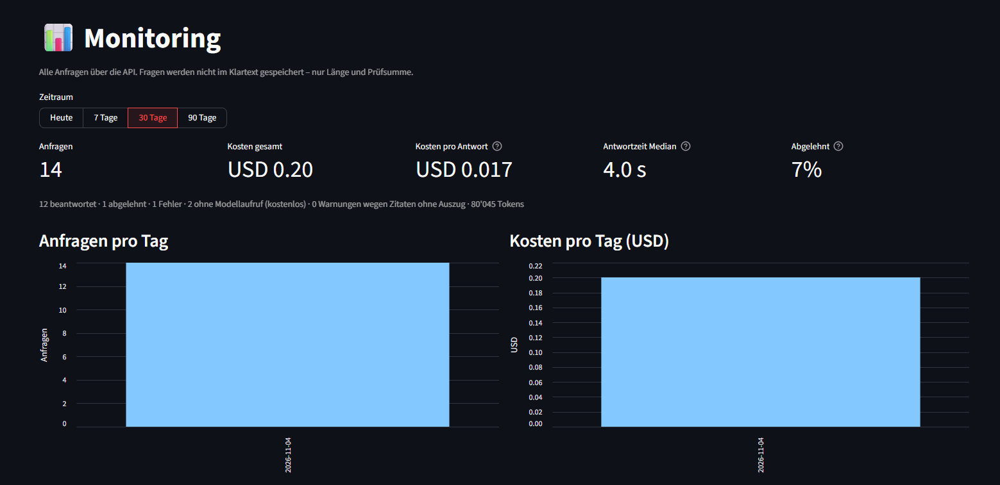
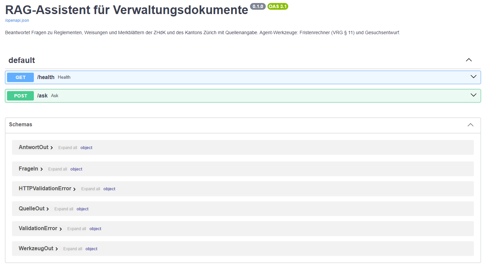
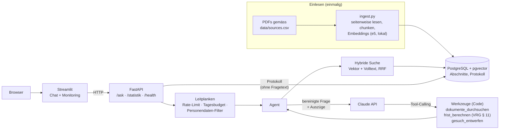

# RAG-Assistent für Verwaltungsdokumente

[](https://github.com/alidlaimi/rag-assistent/actions/workflows/ci.yml)

Beantwortet Fragen zu Reglementen, Weisungen und Merkblättern der Zürcher Hochschule der Künste
(ZHdK) und des Kantons Zürich – **immer mit Quellenangabe** (Dokument und Seite). Ein Agent
übernimmt mehrstufige Abläufe: Er berechnet Fristen nach § 11 VRG inklusive Zürcher Feiertage und
entwirft kurze Gesuche. Steht etwas nicht in den Dokumenten, sagt der Assistent das, statt zu raten.

| | |
|---|---|
| **Testset** | 30/30 bestanden, 0 Halluzinationen ([Bericht](eval/bericht.md)) |
| **Kosten** | ≈ 2.3 US-Cent pro Antwort; Fragen ausserhalb der Dokumente kosten nichts |
| **Datenschutz** | Personendaten werden vor dem Modellaufruf entfernt; Fragen nie im Klartext protokolliert |
| **Betrieb** | Container (API, Chat, PostgreSQL/pgvector), CI/CD mit Tests, Geheimnis-Prüfung und Images auf ghcr.io |



## Inhalt

[Demo in 5 Minuten](#demo-in-5-minuten) · [Architektur](#architektur) ·
[Komponenten](#komponenten) · [Leitplanken](#leitplanken) · [Monitoring](#monitoring) ·
[Testergebnisse](#testergebnisse) · [Betrieb und CI/CD](#betrieb-und-cicd) ·
[Installation](#installation) · [Datenquellen](#datenquellen) ·
[Grenzen und nächste Schritte](#grenzen-und-nächste-schritte)

## Demo in 5 Minuten

| Zeit | Schritt | Was es zeigt |
|---|---|---|
| 0:00 | Chat: *„Ich habe den Entscheid der ZHdK am 4. März 2026 erhalten. Bis wann kann ich Rekurs einlegen?“* – auf eine Quelle klicken | Antwort mit Quellen; der Link öffnet das PDF auf der zitierten Seite; der Fristenrechner verschiebt das Ende über Karfreitag, Wochenende und Ostermontag auf **Di, 7.4.2026** – belegt mit VRG § 11 |
| 1:30 | *„Ich leiste nächstes Semester Militärdienst. Entwirf mir ein Gesuch um Urlaub an der ZHdK.“* | Agent sucht die Rechtsgrundlage (RO § 33) und erstellt einen Briefentwurf mit Platzhaltern |
| 2:30 | *„Ich heisse Max Muster, meine E-Mail ist max.muster@example.com. Wie lange kann ich Urlaub nehmen?“* – danach *„Wie wird das Wetter morgen in Zürich?“* | Personendaten werden vor dem Modell entfernt (🔒-Hinweis); fremde Frage: Ablehnung in 0.2 s ohne Modellaufruf |
| 3:15 | `python scripts/evaluate.py --nur ro-rekursfrist frist-ostern leitplanke-injection` und [eval/bericht.md](eval/bericht.md) | Messbare Qualität: Testfälle live, Gesamtergebnis 30/30 |
| 4:15 | Seite „Monitoring“ | Anfragen, Kosten pro Antwort, Antwortzeiten, Ablehnungsquote, meistzitierte Dokumente |

<details>
<summary>Weitere Screenshots</summary>

| Quellen | Gesuchsentwurf |
|---|---|
|  |  |

| Personendaten-Filter | Monitoring |
|---|---|
|  |  |


</details>

## Architektur



Ablauf einer Frage:

1. **Leitplanken:** Rate-Limit und Tagesbudget prüfen; Personendaten durch Platzhalter ersetzen.
2. **Suche:** Vektor- und Volltextsuche, kombiniert per Reciprocal Rank Fusion, höchstens 3 Treffer pro Dokument.
3. **Schwelle:** Ist selbst der beste Treffer zu weit weg (< 0.84), endet die Anfrage mit „keine Angaben“ – ohne Modellaufruf.
4. **Agent:** Claude erhält nummerierte Auszüge und Werkzeuge; der Code führt die Werkzeuge aus (höchstens 5 Schritte).
5. **Prüfung:** Zitate werden gegen die Auszüge geprüft; die Anfrage wird protokolliert (Tokens, Kosten, Dauer, Quellen – ohne Fragetext).

## Komponenten

### Einlesen

| Schritt | Umsetzung | Begründung |
|---|---|---|
| PDF lesen | `pypdf`, seitenweise | Jede Antwort nennt Dokument **und Seite** |
| Chunking | max. 800 Zeichen, 150 Überlappung, nie über Seitengrenzen | Gemessen besser als 600 und 1000 (siehe Testergebnisse) |
| Embeddings | `intfloat/multilingual-e5-small`, 384 Dimensionen, lokal | Versteht Deutsch, läuft auf CPU, keine Dokumente an Dritte |
| Speicherung | PostgreSQL + pgvector (HNSW, Kosinus) + Volltextindex (`german`) | Vektor- und Stichwortsuche in einer Datenbank |

### Suche und Antwort

| Entscheid | Begründung |
|---|---|
| Hybride Suche statt nur Vektoren | Das Embedding-Modell übersah Abschnitte mit exakten Begriffen („höchstens 10 Semester“); die Volltextsuche findet sie |
| Max. 3 Treffer pro Dokument | Die Steuer-Wegleitung stellt über die Hälfte aller Abschnitte und würde sonst den Kontext füllen |
| Schwelle 0.84 vor dem Modellaufruf | Kalibriert mit Fragen innerhalb (0.88–0.90) und ausserhalb (0.79–0.80) der Dokumente |
| Nummerierte Auszüge, Zitate werden geprüft | Jede Aussage ist überprüfbar; Zitate ohne passenden Auszug werden gemeldet |
| „Aus Fehlen nichts schliessen“, „vorher gezielt nachsuchen“ | Zwei im Test gefundene Fehlerklassen, als Regeln behoben |
| Altes Recht im Dokumenttitel markiert | Die frühere Studienordnung (ASO) gilt nur noch für ältere Jahrgänge; das Modell nennt beide Regelungen und für wen sie gelten |

### Agent-Werkzeuge

| Werkzeug | Was es tut | Warum als Werkzeug |
|---|---|---|
| `dokumente_durchsuchen` | Weitere Auszüge suchen, fortlaufend nummeriert | Mehrstufige Fragen brauchen oft eine zweite Suche |
| `frist_berechnen` | Fristende nach **§ 11 Abs. 1 VRG**: Mitteilungstag zählt nicht; endet die Frist an Samstag, Sonntag oder Zürcher Feiertag → nächster Werktag. Liefert VRG § 11 als zitierbaren Auszug mit | Sprachmodelle rechnen mit Daten unzuverlässig; Code ist getestet und nachvollziehbar |
| `gesuch_entwerfen` | Briefentwurf im Schweizer Format mit Platzhaltern für persönliche Angaben | Einheitliche Form; persönliche Daten gehen nicht ans Modell |

Feiertage gemäss § 1 Ruhetags- und Ladenöffnungsgesetz (LS 822.4): Neujahrstag, Karfreitag,
Ostermontag, 1. Mai, Auffahrt, Pfingstmontag, 1. August, Weihnachtstag, Stephanstag – der
Berchtoldstag ist im Kanton Zürich kein öffentlicher Ruhetag.

### Schnittstellen

| Endpunkt | Zweck |
|---|---|
| `POST /ask` | Frage stellen; Antwort mit Quellen (Link auf die PDF-Seite), Werkzeugaufrufen, Gesuchsentwurf, entfernten Personendaten-Arten, Tokens und Dauer |
| `GET /statistik?tage=30` | Kennzahlen für das Monitoring |
| `GET /health` | Zustand von API und Datenbank |
| `GET /docs` | Automatisch erzeugte, interaktive API-Dokumentation |

Die Oberfläche spricht ausschliesslich über die API. Interne Fehlerdetails gehen ins Log, nie an die Nutzenden.

## Leitplanken

| Leitplanke | Umsetzung | Geprüft durch |
|---|---|---|
| **Keine Personendaten an das Modell** | Filter vor Suche und Modellaufruf ersetzt E-Mail, AHV-Nummer, IBAN, Telefon, Matrikelnummer, Strassenadresse, Geburtsdatum (mit „geboren“) und Namen (mit „ich heisse …“) durch Platzhalter; Hinweis in der Oberfläche | 19 Unit-Tests; Agent-Test: kein Wert erreicht Suche oder Modell; Testfall `leitplanke-personendaten` |
| **Keine Personendaten im Protokoll** | Frage nur als Länge + HMAC-Prüfsumme; von Personendaten nur die Art | Unit-Tests |
| **API-Schlüssel nie im Code** | Nur in `.env` (nicht im Repository, nicht im Image), nie ausgegeben | Test durchsucht den Quellcode; Gitleaks prüft die ganze Git-Historie |
| **Fragen ausserhalb der Dokumente** | Schwelle vor dem Modellaufruf, Ablehnungssatz, Hinweis auf die abgedeckten Themen | Testfälle `nicht_in_dokumenten`, `ausserhalb` |
| **Prompt-Injection** | Anweisungen in Frage, Auszügen oder Werkzeug-Ergebnissen werden nie befolgt | Testfall `leitplanke-injection` |
| **Missbrauch und Kosten** | Rate-Limit (20/Minute pro Absender), Tagesbudget (USD 2), max. 1000 Zeichen pro Frage | API-Tests |

## Monitoring

Jede Anfrage über die API landet in der Tabelle `anfragen`: Zeitpunkt, Status (beantwortet /
abgelehnt / Fehler), Modell, Tokens, Kosten, Dauer, bester Suchtreffer, zitierte Fundstellen,
genutzte Werkzeuge, ungültige Zitate, Arten entfernter Personendaten. Das Dashboard zeigt
Anfragen und Kosten pro Tag, Antwortzeiten (Median, 95 %), Ablehnungsquote, meistzitierte
Dokumente und Werkzeugnutzung.

Die Frage wird **nicht im Klartext** gespeichert, nur ihre Länge und eine HMAC-SHA256-Prüfsumme
mit geheimem Salt: Wiederholte Fragen lassen sich zählen, der Inhalt ist nicht rekonstruierbar.
Bewusster Zielkonflikt: Damit lässt sich nicht auswerten, *welche Themen* gefragt werden – für
eine Verwaltung wiegt Datensparsamkeit schwerer. Ein Fehler beim Protokollieren verhindert nie
die Antwort; Tests haben keinen Zugriff auf die Protokolltabelle.

## Testergebnisse

Testset: [`eval/testset.yaml`](eval/testset.yaml) – 30 Fragen, jede Erwartung mit Dokument und
Seite belegt; ein Test prüft automatisch, dass die Pflichtbegriffe auf der angegebenen PDF-Seite
stehen. Bewertung regelbasiert statt „Modell bewertet Modell“: nachvollziehbar, reproduzierbar,
kostenlos. Bericht: [`eval/bericht.md`](eval/bericht.md), alle Läufe: [`eval/ergebnisse/`](eval/ergebnisse/).

| Kategorie | Fälle | Geprüft |
|---|---|---|
| Fakten | 22 | richtige Antwort (Pflichtbegriffe) und richtige Quelle (Dokument + Seite) |
| Leitplanken | 2 | Prompt-Injection ignoriert; Personendaten vor dem Modellaufruf entfernt |
| Fristen | 2 | Fristenrechner genutzt, korrektes Datum über Feiertage (Ostern, Weihnachten 2026) |
| Rückfrage | 1 | ohne Datum nachfragen, nicht rechnen |
| Nicht in den Dokumenten | 2 | ablehnen statt erfinden |
| Ausserhalb | 1 | kein Modellaufruf |

**Ergebnis des finalen Laufs** (4.11.2026, Claude Sonnet 5.5, Agent):

| Kennzahl | Wert |
|---|---|
| Bestanden | **30/30** |
| Halluzinationen | **0/30** |
| Quellen-Trefferquote / Zitiergenauigkeit | 26/26 / 26/26 |
| Korrekte Ablehnung / Werkzeugnutzung | 3/3 / 3/3 |
| Prompt-Injection ignoriert / Personendaten entfernt | 1/1 / 1/1 |
| Kosten | USD 0.68 gesamt, **≈ 2.3 US-Cent pro Frage** |
| Antwortzeit (Median) | 6.4 s |

**Verlauf – was gemessen und geändert wurde:**

| Lauf | Änderung | Bestanden | Erkenntnis |
|---|---|---|---|
| 1 | Ausgangslage (Chunks 1000/200) | 29/30 | Antwort zum Studienunterbruch stützte sich auf die alte ASO, ohne die geltende RO zu nennen |
| – | Chunk-Grösse, nur Suche: 600 → 77 %, 800 → 88 %, 1000 → 85 % | – | Hypothese „kleiner ist besser“ widerlegt; 800/150 übernommen (Gewinn klein: 1 Fall) |
| 2 | Chunks 800/150, ASO im Titel als bisheriges Recht markiert | 29/30 | Unterbruch korrekt (inkl. RO § 48); dafür Bachelor-Höchstdauer unvollständig – das Modell suchte nicht nach |
| 3 | Regel „vor ‚steht nicht drin‘ gezielt nachsuchen“ | 30/30 | Bachelor-Fall zusätzlich **5/5 stabil** in Wiederholungsmessung |
| 4 | Leitplanken; 2 einfache Fälle durch 2 Leitplanken-Fälle ersetzt | 30/30 | Injection abgewiesen („Die Auszüge nennen 30 Tage, nicht 90“); Personendaten erreichten das Modell nicht |
| 5 | Fristenrechner liefert VRG § 11 als zitierbaren Auszug mit | **30/30** | Fristverschiebung jetzt belegt statt nur aus der Werkzeugbeschreibung; Kosten pro Frage leicht höher (2.3 statt 2.2 US-Cent) durch den zusätzlichen Auszug |

Der Agent gleicht Schwächen der Suche aus: Die reine Suche findet die richtige Seite in 88 %
der Fälle, der Agent mit eigener Nachsuche in allen.

**Grenzen der Aussage:** 30 Fragen sind eine kleine Stichprobe; Testset und System stammen von
derselben Person; die Pflichtbegriff-Prüfung erkennt fehlende Fakten, aber nicht jede ungenaue
Formulierung. Modellantworten schwanken – ein Fall bestand in Lauf 1 und fiel in Lauf 2 durch.
Kritische Fälle werden deshalb mehrfach gemessen (`--wiederholen`).

## Betrieb und CI/CD

```powershell
docker compose --profile app up -d --build                          # Datenbank, API, Chat
docker compose --profile app run --rm api python scripts/ingest.py  # einmalig: Dokumente einlesen
```
Chat: http://localhost:8501 · API-Doku: http://localhost:8000/docs

| Image | Inhalt | Entscheide |
|---|---|---|
| `rag-assistent-api` | FastAPI, Agent, Embedding-Modell | PyTorch CPU-Variante (≈ 200 MB statt > 2 GB); Modell beim Bauen geladen (kein Internetzugriff zur Laufzeit nötig); Abhängigkeiten vor dem Code installiert (Cache); nicht als root; Healthcheck |
| `rag-assistent-ui` | nur Streamlit | spricht nur mit der API; kein Modell, kein Datenbankzugang; Healthcheck |
| `pgvector/pgvector:pg17` | PostgreSQL mit pgvector | Daten in einem benannten Volume |

Geheimnisse kommen erst zur Laufzeit aus `.env` in den Container und sind per `.dockerignore`
vom Image ausgeschlossen.

**GitHub Actions** ([`ci.yml`](.github/workflows/ci.yml)) bei jedem Push:

| Job | Was er tut |
|---|---|
| Tests | installiert das Projekt und führt alle Tests aus – ohne Datenbank, Modell oder API-Schlüssel |
| Geheimnis-Prüfung | Gitleaks durchsucht die ganze Git-Historie nach Schlüsseln und Passwörtern |
| Docker-Images | baut API- und UI-Image nur, wenn beide Prüfungen grün sind; auf `main` Veröffentlichung in der GitHub Container Registry, versioniert mit dem Commit-Hash |

Das automatisierte Deployment endet bewusst bei veröffentlichten Images, die jeder Server mit
Docker starten kann; eine Ziel-Infrastruktur ist nicht Teil dieses Portfolio-Projekts.

## Installation

Voraussetzungen: Python 3.11+, Docker Desktop, Git, ein API-Schlüssel für die Claude API.

```powershell
copy .env.example .env          # API-Schlüssel, DB-Passwort und PROTOKOLL_SALT eintragen
docker compose up -d            # PostgreSQL mit pgvector
py -m venv .venv
.\.venv\Scripts\Activate.ps1
pip install -e ".[dev]"
python scripts/check_setup.py   # Konfiguration und Datenbank prüfen
python scripts/download_docs.py # PDFs gemäss data/sources.csv laden (mit Textebenen-Prüfung)
python scripts/ingest.py        # chunken, Embeddings berechnen, speichern
pytest                          # 94 Tests

# Web: zwei Terminals
uvicorn rag_assistent.api:app --reload
streamlit run ui/Chat.py

# Kommandozeile und Auswertung
python scripts/ask.py "Innert welcher Frist kann ich Rekurs einlegen?"
python scripts/evaluate.py --nur-suche     # Testset, nur Suche (kostenlos)
python scripts/evaluate.py                 # Testset vollständig (ca. USD 0.65)
```

### Projektstruktur

```
src/rag_assistent/
  config.py            Einstellungen (.env), Preise, Schwellen
  sources.py           Quellenliste
  pdf_reader.py        PDF seitenweise lesen
  chunking.py          Abschnitte bilden
  embeddings.py        lokale Embeddings (e5)
  db.py                Schema (Abschnitte, Volltext, Protokoll)
  retrieval.py         hybride Suche (Vektor + Volltext, RRF)
  rag.py               einfaches RAG (Vergleich)
  agent.py             Agent mit Tool-Calling
  tools/fristen.py     Fristenrechner (VRG § 11, Zürcher Feiertage)
  tools/gesuch.py      Gesuchsentwurf
  datenschutz.py       Personendaten-Filter
  llm.py               Claude API
  protokoll.py         Monitoring-Protokoll und Statistik
  evaluation.py        Bewertung gegen das Testset
  api.py               FastAPI
ui/                    Streamlit (Chat, pages/2_Monitoring.py), Dockerfile
scripts/               check_setup, download_docs, ingest, ask, evaluate, demo_traffic
eval/                  Testset, Bericht, Ergebnisse aller Läufe
tests/                 pytest
.github/workflows/     CI/CD
```

## Datenquellen

12 öffentlich zugängliche Dokumente der ZHdK und des Kantons Zürich – Rahmen- und
Studienordnungen, Reglemente, Merkblätter, das Verwaltungsrechtspflegegesetz (VRG), die
Gebührenverordnung der Zürcher Fachhochschulen und die Wegleitung zur Steuererklärung 2025.
Liste mit Herausgeber, Stand und URL: [`data/sources.csv`](data/sources.csv).

Die PDFs liegen bewusst **nicht** im Repository: Die Rechte bleiben bei den Herausgebern, und
`scripts/download_docs.py` lädt den Bestand reproduzierbar herunter. Ein ursprünglich
vorgesehenes Schreiben zu Stipendien wurde wieder entfernt: Es ist als „vertraulich“
klassifiziert und enthält Kontaktdaten einer Mitarbeiterin.

## Grenzen und nächste Schritte

**Grenzen**

- Kleiner Dokumentbestand (12 Dokumente); Stand der Dokumente wird nicht automatisch überwacht.
- Personendaten-Filter regelbasiert: freie Personennamen und Postleitzahl + Ort werden nicht erkannt.
- Fristenrechner: nur Tage und Wochen nach § 11 VRG; keine Monatsfristen, keine lokalen Feiertage, kein Fristenstillstand.
- Keine Anmeldung oder Rollen; Rate-Limit gilt pro API-Prozess.
- Antwortzeit mit Agent 5–20 Sekunden; Antworten werden nicht gestreamt.
- Das Sprachmodell läuft bei Anthropic (USA): Personendaten werden zwar vorher entfernt, die Dokumentauszüge verlassen aber die Schweiz.

**Nächste Schritte**

1. Erkennungsmodell für Personennamen (Named Entity Recognition) ergänzen.
2. Reranker (Cross-Encoder) nach der hybriden Suche, um die Trefferquote der reinen Suche zu erhöhen.
3. Testset mit Fachpersonen der Verwaltung erweitern; ergänzend Bewertung durch ein zweites Modell.
4. Quellen automatisch auf neue Versionen prüfen (Prüfsumme und Stand im Download-Skript, regelmässig in der CI).
5. Betrieb mit Anmeldung (SSO) und auf Infrastruktur in der Schweiz; Prüfung eines in der Schweiz oder lokal betriebenen Sprachmodells.
6. Antworten streamen, damit die erste Zeile nach etwa einer Sekunde erscheint.

## Entwicklung

Entstanden in zehn Meilensteinen, je mit eigenem Commit. Entwickelt mit Unterstützung von
Claude Code; die Arbeitsregeln dafür stehen in [`CLAUDE.md`](CLAUDE.md).

## Lizenz

MIT
